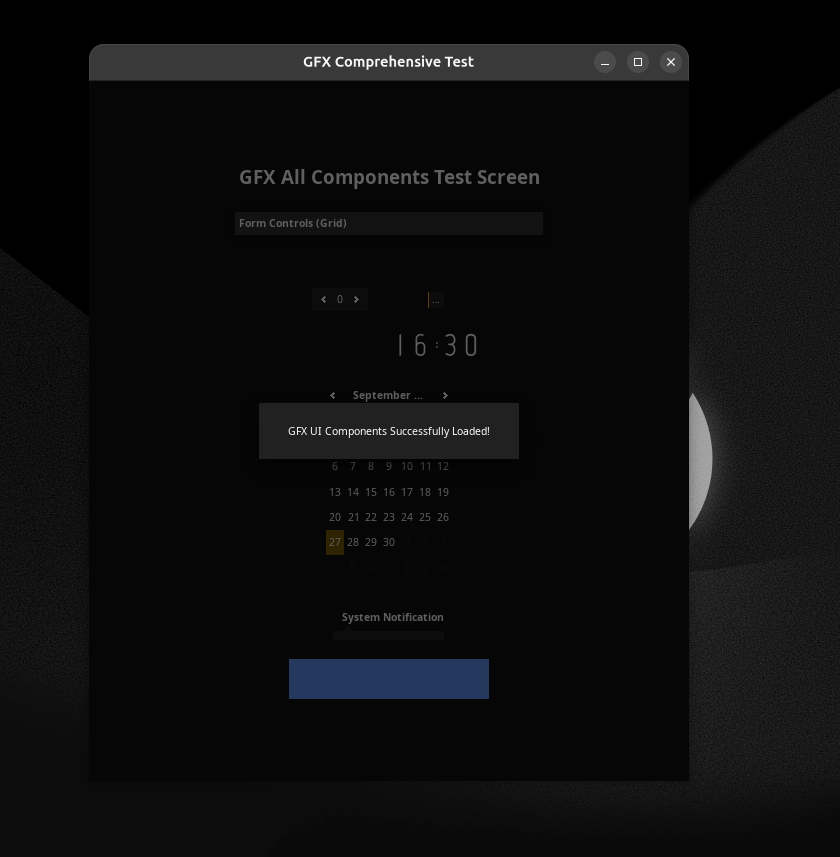
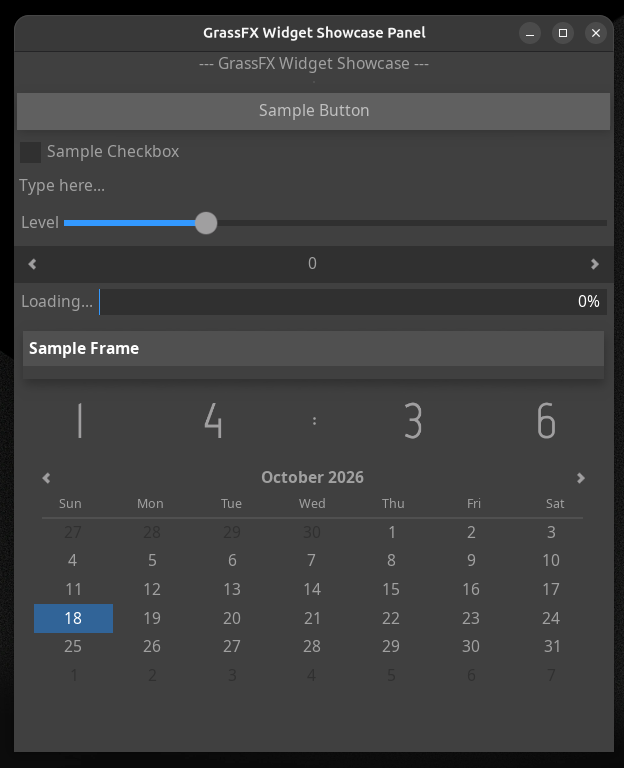

# GrassProject Evolution & Release Log

## Release Timeline

### **September 17, 2026** - GrassProject 0.01

> **Status:** Initial Foundation
>
> **Summary:** The Elementary library of the Enlightenment Foundation Libraries (EFL) was successfully abstracted at a fundamental, baseline level.

### **September 20, 2026** - GrassProject 0.02

> **Status:** Expansion Phase
>
> **Summary:** Over half of the Elementary library was abstracted, making significant progress toward a comprehensive wrapper, though the integration process remained ongoing.

### **September 27, 2026** - GrassProject 0.03

> **Status:** Robust Abstraction
>
> **Summary:** Refined to meet **99%** of the Elementary needs for **90 out of 100 projects**. Implementation and abstraction for **Evas** reached a near-identical level of maturity and coverage.

### **October 18, 2026** - GrassProject 0.1

> **Status:** Milestone Core Release
>
> **Summary:** The **Ecore** library was fully abstracted. Combined with Elementary, Evas, and Ecore, the framework now fulfills **99%** of the combined library needs for **90 out of 100 projects** from our perspective. Syntax was polished for clarity, and a brand-new developer guide was introduced.

### **October 30, 2026** - GrassFX 0.2

> **Status:** Refinement & DX Enhancement
>
> **Summary:** Resolved missing function bindings across the framework and fully refreshed the developer guides. File names and structures were sanitized for improved project organization. The necessity to manually rely on legacy `elm_` and `evas_` functions has been significantly reduced, streamlining the overall API footprint.
>

## Summary of Core Coverage

| Library / Component | Abstraction Status | Estimated Project Coverage | 
| ----- | ----- | ----- | 
| **Elementary** | Fully Integrated | 99% needs (90/100 projects) | 
| **Evas** | Fully Integrated | 99% needs (90/100 projects) | 
| **Ecore** | Fully Integrated | 99% needs (90/100 projects) | 
| **GrassFX (0.2)** | Enhanced API & Binding Fixes | Legacy prefix dependency minimized | 

> If you would like to access the guide website, you can visit the guides by clicking on the following link: <https://www.grassproject.net/>
